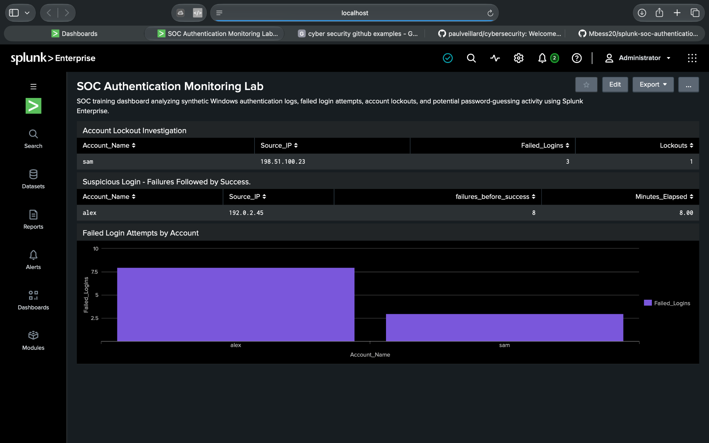
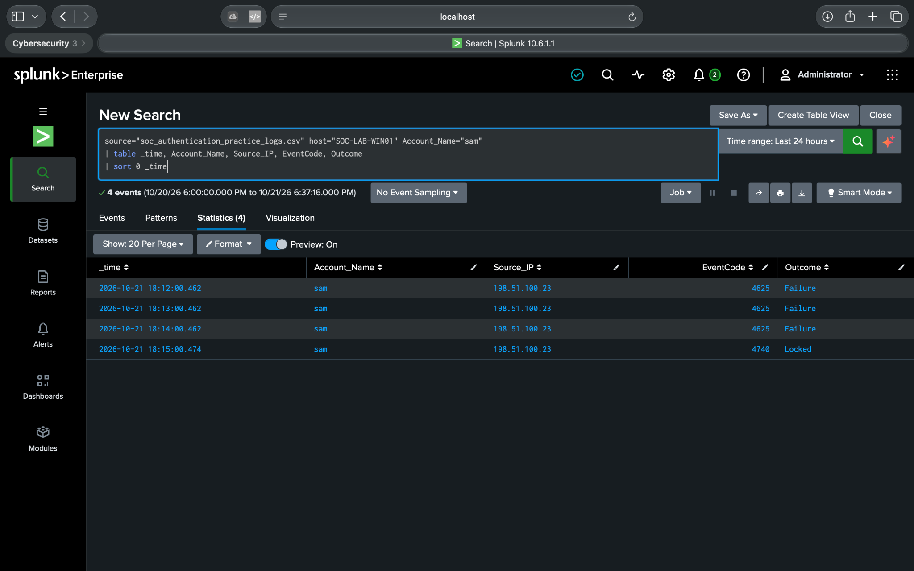
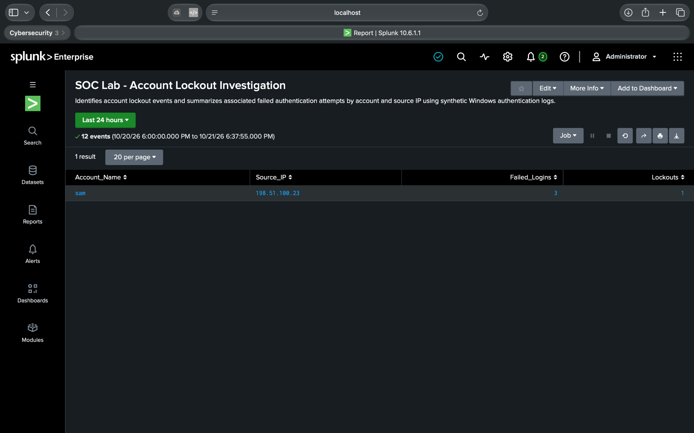
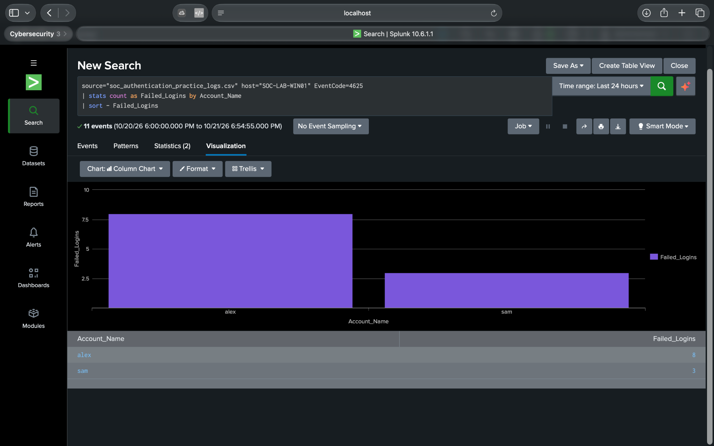

# SOC Authentication Monitoring & Detection Lab | Splunk Enterprise

**Hands-On Cybersecurity Portfolio Project | SOC Analysis • SIEM Monitoring • Threat Detection**

> **Training Environment:** This project uses synthetic Windows authentication events. It is a simulated SOC investigation, not a real security incident.

## Project Overview

In this hands-on Security Operations Center (SOC) lab, I used Splunk Enterprise to ingest, search, correlate, and visualize Windows authentication events.

The objective was to investigate suspicious authentication patterns, including repeated failed login attempts, successful logins following multiple failures, and account lockouts.

Through this project, I practiced foundational Tier 1 SOC analyst responsibilities, including:

- Security log ingestion and field validation
- SIEM monitoring and event analysis
- Splunk Search Processing Language (SPL)
- Authentication event correlation
- Suspicious login detection
- Account lockout investigation
- Dashboard creation and visualization
- Security investigation documentation

## Lab Environment

| Component | Configuration |
|---|---|
| SIEM Platform | Splunk Enterprise 10.6.1 |
| Operating System | macOS |
| Data Source | Synthetic Windows authentication CSV |
| Simulated Host | `SOC-LAB-WIN01` |
| Sourcetype | `csv` |
| Total Events | 14 |
| Event Date | October 21, 2026 |
| Event Time Range | 18:00–18:18 |
| Investigation Type | Authentication Monitoring |

### Windows Security Event IDs

| Event ID | Description | Count |
|---|---|---|
| 4625 | Failed logon | 11 |
| 4624 | Successful logon | 2 |
| 4740 | Account lockout | 1 |
| **Total** | **Authentication events analyzed** | **14** |

## Investigation Objectives

1. Identify accounts experiencing repeated authentication failures.
2. Investigate suspicious successful logins following failed attempts.
3. Detect and analyze account lockout activity.
4. Correlate authentication events using SPL.
5. Build a Splunk dashboard for monitoring authentication patterns.
6. Document investigation findings and recommended SOC analyst actions.

## Investigation Findings

### Finding 1: Suspicious Authentication Sequence

**Account:** `alex`  
**Source IP:** `192.0.2.45`

The account experienced eight consecutive failed authentication attempts between 18:00 and 18:07, followed by a successful login at 18:08.

**Observed activity:**

- Failed logins: 8
- Successful logins: 1
- Time elapsed from first failure to success: 8 minutes
- Detection result: Matched the lab's failed-logins-followed-by-success correlation search

**Analyst Assessment:**

This pattern is consistent with potential password-guessing activity and would warrant further investigation in a production environment.

However, successful authentication after repeated failures does not independently establish unauthorized access or malicious intent.

### Finding 2: Account Lockout Investigation

**Account:** `sam`  
**Source IP:** `198.51.100.23`

Three failed authentication attempts occurred between 18:12 and 18:14, followed by an account lockout at 18:15.

**Observed activity:**

- Failed logins: 3
- Account lockouts: 1
- Successful logins observed: 0

**Analyst Assessment:**

The activity demonstrates an account lockout following repeated authentication failures.

Additional investigation would be required to distinguish incorrect password entry, application configuration issues, and potentially malicious activity.

### Finding 3: Additional Successful Authentication

**Account:** `jordan`  
**Source IP:** `203.0.113.12`

One successful authentication was recorded at 18:18, with no preceding failures observed in the dataset.

No suspicious authentication sequence was established for this account.

## Splunk Investigation Workflow

### Step 1: Data Ingestion

Imported the synthetic authentication CSV into Splunk Enterprise using the Add Data workflow.

Configured the following:

- Source type: `csv`
- Host: `SOC-LAB-WIN01`
- Dataset: `soc_authentication_practice_logs.csv`

Verified that 14 events were indexed and relevant authentication fields were available for searching.

### Step 2: Authentication Event Analysis

Used SPL to count Windows authentication events and identify accounts with repeated failed logins.

Example search:

```spl
source="soc_authentication_practice_logs.csv" host="SOC-LAB-WIN01" EventCode=4625
| stats count as Failed_Logins by Account_Name
| sort - Failed_Logins
```

**Results:** `alex` had eight failed logins and `sam` had three.

### Step 3: Failed Login Correlation

Developed and tested a time-ordered SPL search to identify successful logins following at least five preceding failures for the same account and source IP, where the success occurred within 600 seconds of the first counted failure.

```spl
source="soc_authentication_practice_logs.csv" host="SOC-LAB-WIN01" (EventCode=4624 OR EventCode=4625)
| sort 0 Account_Name Source_IP _time
| streamstats count(eval(EventCode=4625)) as failures_before_success earliest(eval(if(EventCode=4625,_time,null()))) as first_failure_time by Account_Name Source_IP reset_after="(EventCode=4624)"
| where EventCode=4624 AND failures_before_success>=5 AND (_time-first_failure_time)<=600
| eval Minutes_Elapsed=round((_time-first_failure_time)/60,2)
| table Account_Name Source_IP failures_before_success Minutes_Elapsed
```

**Detection Result:**

| Account | Source IP | Failures Before Success | Minutes Elapsed |
|---|---|---|---|
| `alex` | `192.0.2.45` | 8 | 8.00 |

This query was developed for a controlled training dataset. It is not a production-ready rolling-window detection and would require additional validation and tuning before operational deployment.

### Step 4: Account Lockout Investigation

Created an SPL search to identify accounts associated with Windows Event ID 4740.

```spl
source="soc_authentication_practice_logs.csv" host="SOC-LAB-WIN01" (EventCode=4625 OR EventCode=4740)
| stats count(eval(EventCode=4625)) as Failed_Logins count(eval(EventCode=4740)) as Lockouts by Account_Name, Source_IP
| where Lockouts >= 1
| table Account_Name, Source_IP, Failed_Logins, Lockouts
```

**Result:** `sam` — three failed logins and one account lockout.

### Step 5: Dashboard Creation

Created a Classic dashboard titled **SOC Authentication Monitoring Lab**, containing three panels:

1. Account Lockout Investigation
2. Suspicious Login — Failures Followed by Success
3. Failed Login Attempts by Account

The dashboard consolidates investigation results into a visual monitoring interface.

## Dashboard and Investigation Evidence

All screenshots below were captured during the hands-on Splunk lab.

### 1. SOC Authentication Monitoring Dashboard

The completed dashboard displays account lockout results, suspicious login correlation, and failed authentication counts.



### 2. Failed Login Investigation

Investigation of repeated authentication failures and the suspicious authentication sequence.



### 3. Account Lockout Investigation

Saved investigation report identifying the account associated with repeated failed logins and an account lockout.



### 4. Failed Login Visualization

Visualization comparing failed authentication attempts by account.



## SOC Analyst Triage and Response

If these events were observed in a production environment, recommended investigation steps would include:

1. Validate whether the authentication attempts were expected and authorized.
2. Investigate the source IP addresses, affected accounts, and destination systems.
3. Review additional Windows security events and endpoint telemetry.
4. Correlate authentication activity with identity-provider logs and MFA events.
5. Determine whether the successful authentication represents legitimate activity or possible unauthorized access.
6. Review account lockout policy and related authentication history.
7. Escalate findings according to established SOC procedures if corroborating evidence supports suspicious activity.

No containment or remediation actions were performed because this was a synthetic training exercise.

## Supporting Documentation

- [SOC Investigation Report — Word Document](reports/SOC_Investigation_Report.docx)
- [Synthetic Authentication Dataset](data/soc_authentication_practice_logs.csv)
- [Splunk Detection Queries](queries/)
- [Investigation Screenshots](screenshots/)

## Limitations

This investigation was conducted using a small, synthetic dataset containing 14 events.

The source IP addresses belong to reserved documentation ranges and do not identify real attacker infrastructure.

The simplified CSV does not include complete Windows event metadata, endpoint telemetry, network context, or identity-provider information.

In real Windows security logs, Event ID 4740 does not necessarily provide a source IP in the same format as this synthetic dataset.

The correlation logic demonstrates a specific sequence-based detection condition and has not been validated for production scheduling, out-of-order events, or continuous monitoring.

**The observed patterns do not confirm malicious activity or account compromise.**

## Skills Demonstrated

| Skill Area | Practical Experience |
|---|---|
| SIEM | Splunk Enterprise |
| Security Monitoring | Windows authentication event analysis |
| SPL | Filtering, aggregation, statistics, event correlation |
| Threat Detection | Suspicious authentication sequence identification |
| Incident Triage | Failed login and account lockout investigation |
| Data Visualization | Splunk Classic dashboards |
| Reporting | SOC investigation documentation |
| Security Analysis | Evidence-based assessment and recommended next steps |

## Conclusion

This project provided hands-on experience performing authentication log analysis and investigating potential security indicators in Splunk Enterprise.

I successfully ingested synthetic Windows authentication events, developed SPL searches, identified suspicious authentication patterns, investigated an account lockout, created saved reports, and built a monitoring dashboard.

The exercise strengthened my understanding of SIEM workflows, authentication monitoring, event correlation, and the importance of distinguishing suspicious activity from confirmed security incidents.

**Project Status:** Completed — Hands-On SOC Training Lab

---

**Disclaimer:** All authentication data is synthetic and intended exclusively for cybersecurity education and portfolio demonstration.
